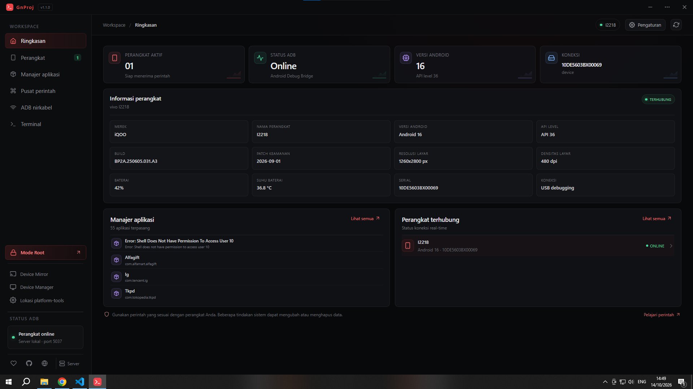
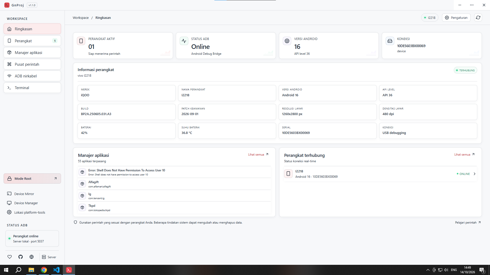
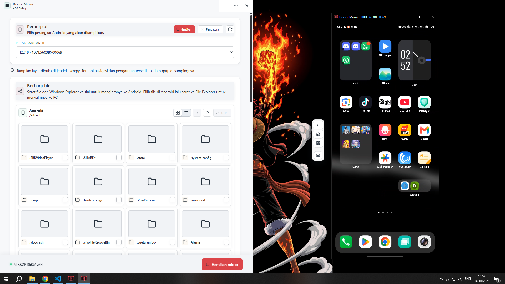
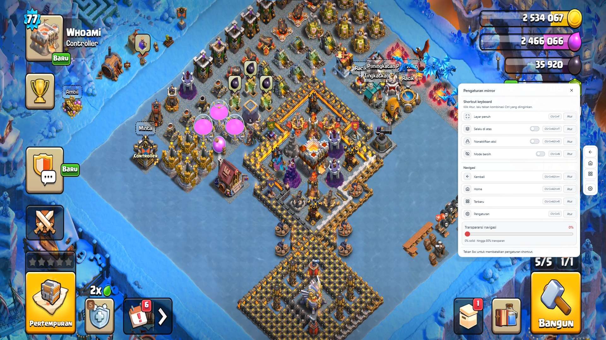

# Struktur Proyek dan Peta Layar ADB GnProj

# Struktur Proyek dan Peta Layar ADB GnProj

<table>
  <tr>
    <td>
      <a href="img/drak.png" target="_blank">
        
      </a>
    </td>
    <td>
      <a href="img/light.png" target="_blank">
        
      </a>
    </td>
  </tr>
  <tr>
    <td>
      <a href="img/device-mirror.png" target="_blank">
        
      </a>
    </td>
    <td>
      <a href="img/mirror-layar-penuh.png" target="_blank">
        
      </a>
    </td>
  </tr>
</table>

Dokumen ini menggambarkan susunan aplikasi yang ada saat ini. ADB GnProj adalah aplikasi desktop Electron + React; navigasi utamanya **bukan URL route** dan tidak memakai React Router. Perpindahan halaman utama menggunakan state `page` di `src/main.jsx`. Parameter query `window` dipakai untuk memilih layar khusus pada jendela Electron.

## 1. Struktur direktori

```text
Adb-GnProj-main/
|-- electron/
|   |-- main.js                    # Proses utama: jendela, ADB, IPC, scrcpy, file, root/driver
|   |-- preload.cjs                # API aman window.adbApp untuk renderer
|   |-- mirror-window-action.ps1   # Bantuan operasi jendela mirror di Windows
|   `-- mirror-window-tracker.ps1  # Pelacakan jendela proses mirror
|-- src/
|   |-- main.jsx                   # Aplikasi React, halaman, dan layar khusus
|   `-- style.css                  # Gaya aplikasi dan seluruh variasi layar
|-- public/                        # Aset statis yang disalin oleh Vite
|-- icons/                         # Ikon aplikasi dan installer
|-- vendor/
|   `-- scrcpy-win64/              # Biner scrcpy yang dikemas bersama aplikasi
|-- build/                         # Aset dan konfigurasi installer NSIS
|-- index.html                     # Dokumen HTML renderer dan mount point #root
|-- vite.config.js                 # Konfigurasi build renderer ke renderer-dist/
|-- package.json                   # Dependensi, perintah, dan konfigurasi electron-builder
|-- package-lock.json
|-- platform-tools-latest-windows.zip # Platform-tools ADB untuk distribusi
|-- renderer-dist/                 # Hasil build Vite; dibuat saat build
`-- installer-final/               # Hasil installer Windows; dibuat saat build
```

`node_modules/` berisi dependensi lokal. `renderer-dist/` dan `installer-final/` merupakan keluaran build, bukan sumber aplikasi.

## 2. Peta navigasi aplikasi utama

Semua halaman berikut dirender di jendela utama oleh `App` dalam `src/main.jsx`. Pemilihan perangkat aktif dibagikan antarhalaman.

| ID halaman (`page`) | Label navigasi | Konten / tanggung jawab |
| --- | --- | --- |
| `dashboard` | Ringkasan | Status ADB, perangkat aktif, ringkasan informasi perangkat dan aplikasi. Halaman awal. |
| `devices` | Perangkat | Daftar perangkat ADB, pemilihan perangkat aktif, refresh, dan pintasan koneksi nirkabel. |
| `apps` | Manajer aplikasi | Daftar dan pencarian aplikasi pihak ketiga, pemasangan APK, serta penghapusan aplikasi terpilih. |
| `commands` | Pusat perintah | Katalog perintah ADB, pencarian, eksekusi, output/log, dan penghentian perintah berjalan. |
| `wireless` | ADB nirkabel | Pairing Wireless debugging dan koneksi ke alamat IP/port. |
| `terminal` | Terminal | Eksekusi perintah ADB atau shell Android, riwayat, output, dan kontrol proses. |

Navigasi samping tambahan membuka fungsi di luar halaman utama:

| Aksi | Tujuan |
| --- | --- |
| Mode Root | Membuka jendela khusus pemeriksaan/root, fastboot, dan dukungan driver. |
| Device Mirror | Membuka jendela mirror perangkat dan pengelola file Android. |
| Device Manager | Membuka Device Manager Windows. |
| Lokasi platform-tools | Memilih executable ADB alternatif. |
| Pengaturan | Membuka dialog preferensi tema, font, dan zoom di jendela utama. |
| Server | Membuka dialog status dan kontrol server ADB lokal. |
| Tautan sosial | Meminta konfirmasi sebelum membuka tujuan eksternal. |

Dialog perintah, pencarian package, konfirmasi aksi, pengaturan, dan status server adalah overlay/modal pada jendela utama, bukan halaman atau route tersendiri.

## 3. Jendela khusus Electron

Proses renderer yang sama memilih tampilan berdasarkan query `window` pada URL:

| Query | Komponen renderer | Dibuka dari |
| --- | --- | --- |
| `?window=root` | `RootModeWindow` | Aksi **Mode Root** |
| `?window=mirror` | `MirrorWindow` | Aksi **Device Mirror** |
| `?window=controls` | `MirrorControlsOverlay` | Kontrol terpisah untuk sesi mirror |
| Tanpa `window` | `App` | Jendela utama |

Jendela Root dan Mirror merupakan `BrowserWindow` yang dibuat dari `electron/main.js`; keduanya tetap menggunakan `src/main.jsx` sebagai renderer. Mirror juga menjalankan scrcpy sebagai proses eksternal. Pratinjau file memakai protokol `mirror-preview` yang ditangani proses utama.

## 4. Batas tanggung jawab dan alur data

```text
src/main.jsx (React renderer)
        | window.adbApp: API yang diekspos secara terbatas
        v
electron/preload.cjs (contextBridge + ipcRenderer)
        | invoke/send dan event IPC
        v
electron/main.js (proses utama)
        |-- ADB / platform-tools
        |-- scrcpy dan jendela mirror
        |-- operasi file dan screenshot
        |-- fastboot, root, dan dukungan driver Windows
        `-- preferensi aplikasi, jendela, dan tautan eksternal
```

- **Renderer (`src/`)** menangani tampilan, state antarmuka, input, dan presentasi hasil.
- **Preload (`electron/preload.cjs`)** menjadi jembatan terkontrol; renderer memanggil `window.adbApp`, bukan API Node/Electron secara langsung.
- **Main process (`electron/main.js`)** menjalankan operasi sistem dan mendaftarkan handler IPC. Hasil dan event dikirim kembali ke renderer melalui preload.
- **Build** memakai Vite untuk menghasilkan renderer ke `renderer-dist/`, lalu electron-builder mengemas proses Electron, aset, platform-tools, dan scrcpy untuk installer Windows.

## 5. Titik masuk dan perintah pengembangan

- HTML renderer: `index.html` → `src/main.jsx` → mount React pada elemen `#root`.
- Proses desktop: `package.json` menunjuk `electron/main.js` sebagai `main`.
- Pengembangan: `npm run dev` menjalankan Vite dan Electron.
- Build installer: `npm run build` membangun renderer lalu membuat installer NSIS Windows.